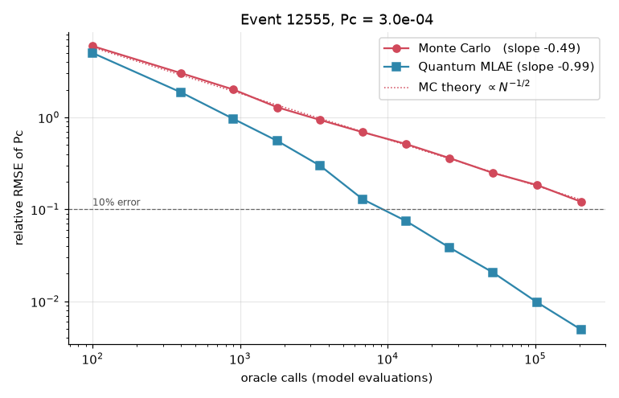
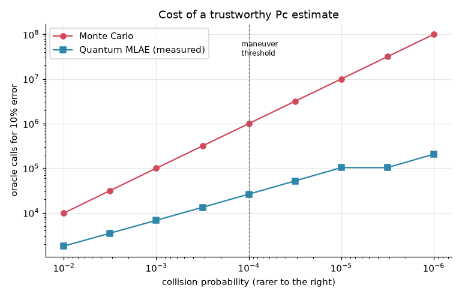

# Q-Avoid

**Quantum amplitude estimation for satellite collision risk, tested on real ESA conjunction data.**

Satellite operators decide whether to burn fuel on an avoidance maneuver based on the probability of collision (Pc), and a typical trigger is Pc ≥ 1e-4. Pc is a rare-event probability, and that is exactly where Monte Carlo is expensive. Q-Avoid swaps the estimation step for a quantum subroutine, maximum-likelihood amplitude estimation (MLAE), and compares it with Monte Carlo at **equal cost**, measured in calls to the uncertainty model.

## Results

All results use the last CDM of 365 real events from the ESA Kelvins Collision Avoidance dataset, simulated on Qiskit 2.x.

| | Monte Carlo | Quantum MLAE |
|---|---|---|
| Error scaling with budget N (fitted slope) | N^-0.49 | N^-0.99 |
| Rel. error at 205,700 calls (event with Pc = 3e-4) | 12.1% | 0.5% |
| Calls for 10% error at Pc = 1e-4 | ~1,000,000 | 26,200 (38x fewer) |
| Calls for 10% error at Pc = 1e-6 | ~100,000,000 | 205,700 (486x fewer) |
| Correct maneuver calls at 6,800 calls/event (286 events) | 87.6% | 97.7% |
| ...on hard cases, Pc within 5x of threshold (103 events) | 72.3% | 93.7% |




## How it works

1. **Data → geometry** (`qavoid/encounter.py`): we project the relative position, velocity and both objects' covariances from each CDM onto the encounter plane (the short-term encounter model). With a 10 m hard-body radius, our median Pc is within 0.05 orders of magnitude of ESA's reported value.
2. **Classical baseline** (`qavoid/classical.py`): a reference integral over the hard-body disk serves as ground truth, alongside Monte Carlo.
3. **Quantum subroutine** (`qavoid/quantum.py`), 7 qubits:
   - Load the cell probabilities p_i of an 8×8 grid on the encounter plane. The x and y registers are prepared independently.
   - A uniformly-controlled RY writes the conditional hit probability f_i onto a "hit" qubit, so P(hit) = Σ p_i f_i = Pc exactly.
   - Grover amplification Q = A S₀ A† S_χ, followed by MLAE over k = 0, 1, 2, 4, …
4. **Fair accounting:** one Monte Carlo sample costs 1 call, and one shot of A·Q^k costs 2k+1 calls.

For large sweeps, both methods use exact statistical shortcuts: binomial hit counts in place of explicit sampling. The notebook checks each shortcut against the real sampler or Qiskit circuits.

## Limits

- The advantage is in **query complexity**, not wall-clock time on today's simulators or hardware.
- In this 2D Gaussian toy, the oracle data (p_i, f_i) is computed classically. A real advantage needs a reversible circuit for a high-fidelity uncertainty model, where sampling is the only option.
- Results come from ideal simulation. The deepest circuit (k = 32) has about 8,600 CNOTs, so noise would cap the usable k on current devices.
- The hard-body radius is assumed, and the chaser covariance frame is approximated, because the dataset is anonymised.

## Run it

```bash
python -m venv .venv && .venv/Scripts/activate      # Windows
pip install -r requirements.txt               # enough for main.py
pip install -r requirements-notebook.txt      # extras for the notebook
python main.py                                # standalone run, ~2 min
# Get the dataset: https://zenodo.org/records/4463683
# extract kelvins_competition_data/train_data.zip -> data/train_data.csv
jupyter notebook q_avoid.ipynb
```

The full notebook runs in about 6 minutes on a laptop CPU. No GPU is needed, since the circuits use only 7 qubits.

## References

- Uriot et al., *Spacecraft Collision Avoidance Challenge: design and results of a machine learning competition*, 2020, arXiv:2008.03069 ([dataset](https://zenodo.org/records/4463683))
- Suzuki et al., *Amplitude estimation without phase estimation*, Quantum Inf. Process. 19, 75 (2020)
- Alfano, *A numerical implementation of spherical object collision probability*, J. Astronaut. Sci. (2005)
